# FlowTrack

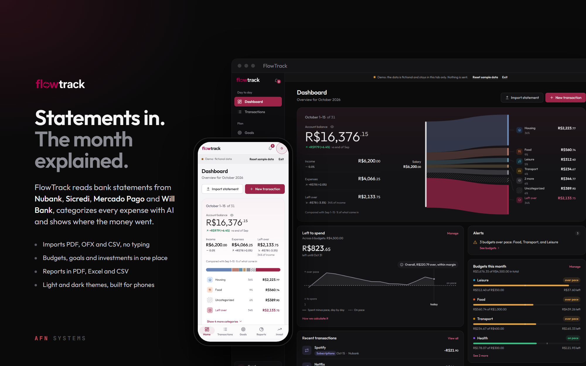

FlowTrack is a personal finance app. It reads bank statements (PDF, OFX or CSV), categorizes every expense with AI and turns the month into budgets, goals, a cash-flow projection and reports you can export. It has a FastAPI backend on Supabase, a React frontend, and a demo that runs entirely in the browser, so anyone can try it without signing up.

[](https://github.com/alyssom-fernandes/FlowTrack/actions/workflows/test.yml)
[](https://github.com/alyssom-fernandes/FlowTrack/actions/workflows/e2e.yml)


**Live demo: [flowtrack-afn.vercel.app](https://flowtrack-afn.vercel.app)** · This README is also available in [Portuguese](README.pt-br.md).

## In 30 seconds

1. Open the [live demo](https://flowtrack-afn.vercel.app) and click **Try the demo**. No account, no server: the data is fictitious and stays in your browser tab.
2. On the **Dashboard**, follow the month's money: what came in, which categories it went to and what was left. Below it, **How much I can still spend** compares this month's spending with the pace of your budgets (fixed bills count on the day they are due).
3. In **Transactions**, click **Import** and drop any PDF: the demo answers with a sample Nubank statement. Before saving, each line shows the suggested category and its confidence; after importing, whatever has no category or less than 85% confidence lands in **To review**, confirmed with one click.
4. In **Reports**, pick a period and follow the money in the **Flow** section, then **Export** as a PDF, an Excel workbook or a CSV.
5. In **Profile**, switch the language to Portuguese or the theme to light.

## Screens

Captured from the demo, in English.

| Dashboard, dark theme | Transactions, light theme |
|---|---|
| 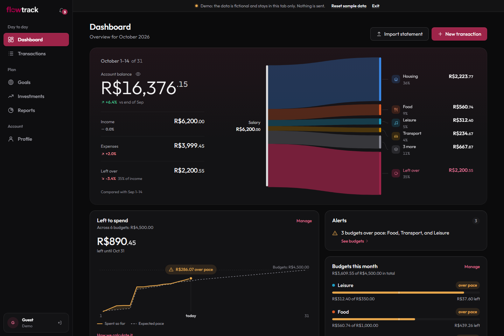 | 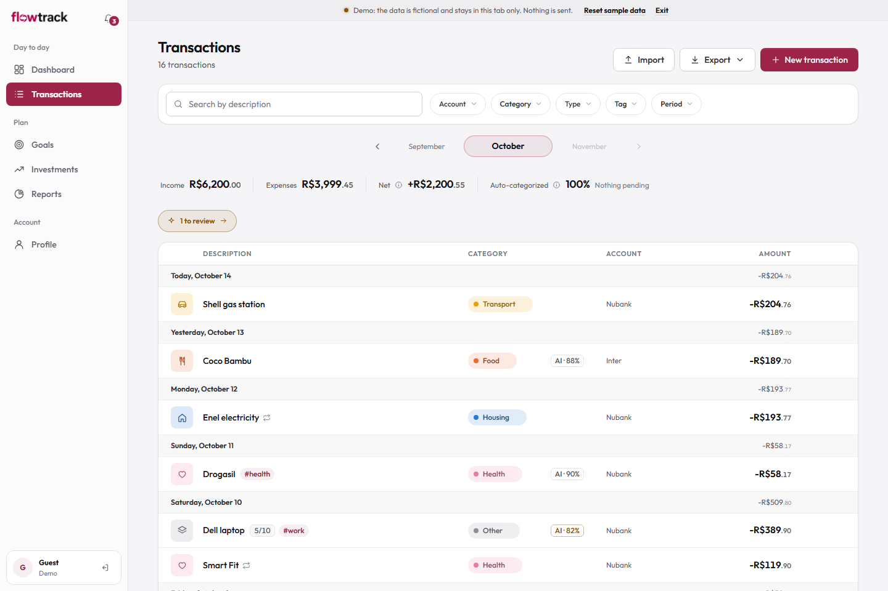 |
| **Reports, light theme** | **Importing a statement, dark theme** |
| 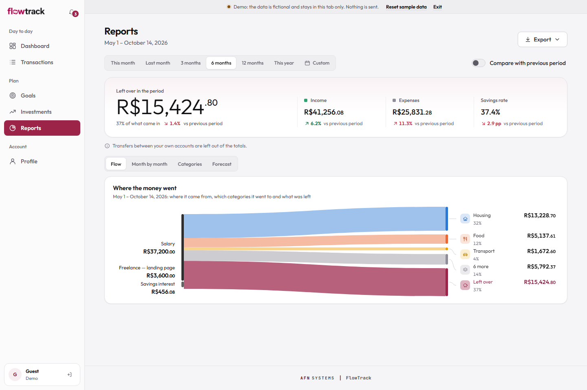 | 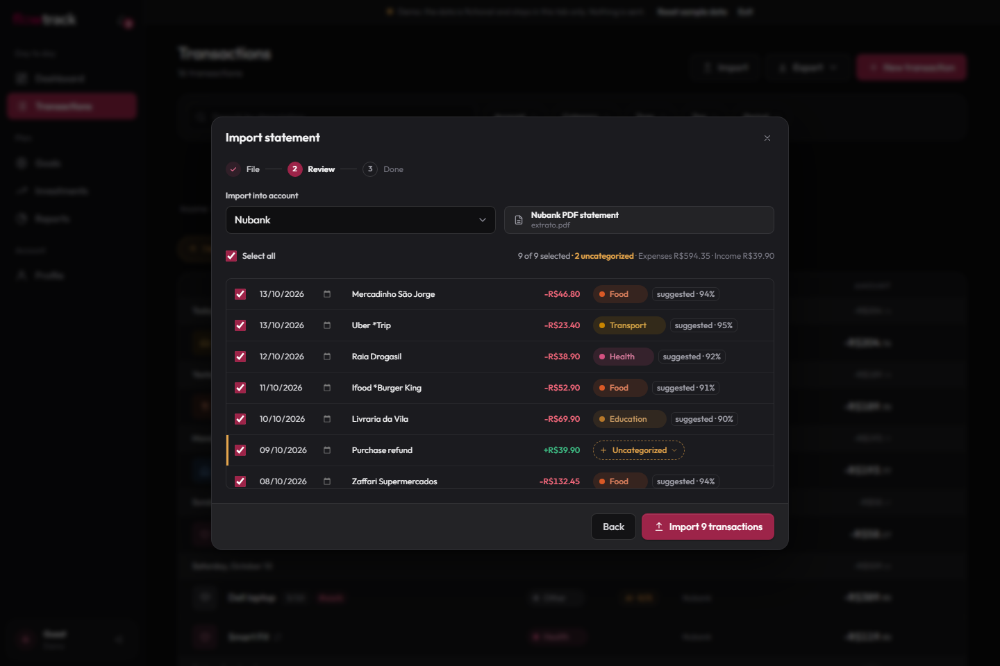 |
| **Budgets, dark theme** | **Sign in, with the demo first** |
| 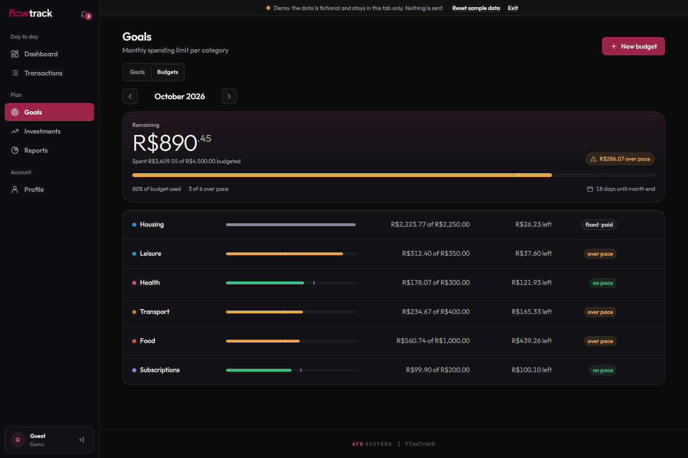 | 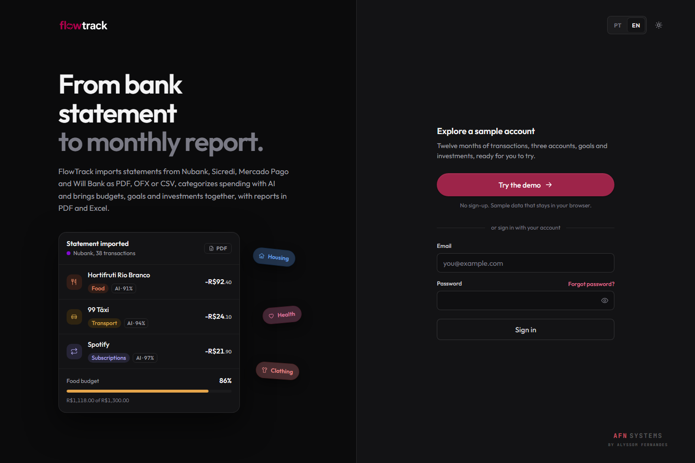 |

| On a phone, light theme | On a phone, dark theme | The report as a PDF |
|---|---|---|
| 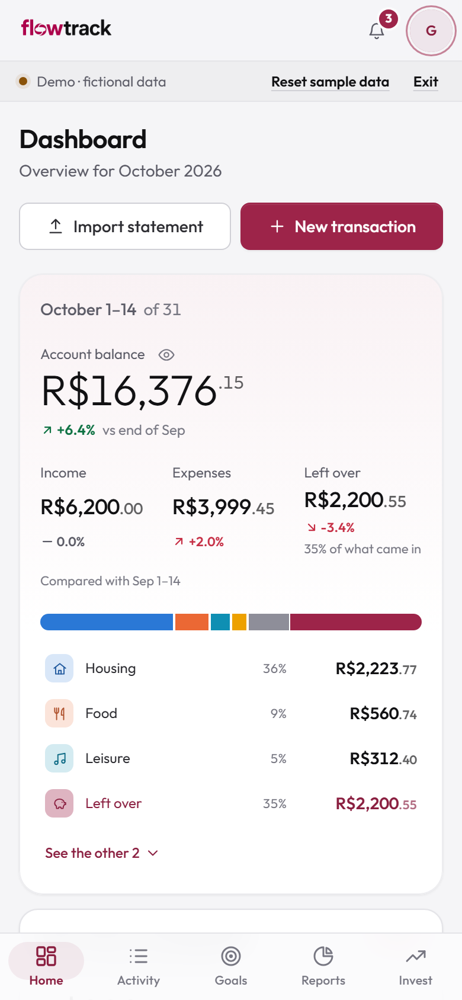 | 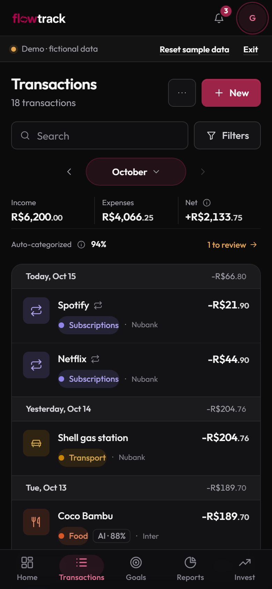 | 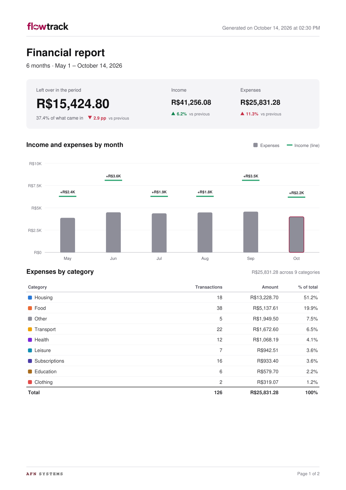 |

---

## Features

- **Statement import.** PDF statements from Nubank, Sicredi, Mercado Pago and Will Bank, plus OFX from any bank and CSV with column mapping. Every import is previewed before it is saved, PDF and OFX lines come with a suggested category (fixed rules, no AI) that can be changed, and duplicates are skipped.
- **AI categorization in three layers.** Fixed rules for known merchants first, then the user's merchant cache, then Claude Haiku for what is left. Each transaction shows how it was categorized and with what confidence; anything without a category or below 85% confidence is gathered in **To review**.
- **Dashboard.** The month's money flow (income split into spending categories and what was left), compared with the same days of last month; how much can still be spent at the pace of the budgets; a 30-day balance projection from recurring payments and installments; net worth over 12 months; the budgets that need attention first; alerts grouped by subject, each with an action; and a short monthly summary written by AI. Amounts can be hidden with one click.
- **Transactions.** Month by month, grouped by day with daily totals, filter chips (account, category, type, tag, period) and search, installments ("5/10"), recurring payments, tags, transfers between accounts, inline categorization and a **To review** mode. Each category keeps the same color on every screen and in the exports.
- **Budgets and goals.** Monthly budgets per category, measured against the pace of the month: on pace, over pace, over budget, or *fixed · paid* when a category is almost all fixed bills that were already paid. The alert, the bar and the status always say the same thing, and the API raises alerts by the same rule. Goals for spending limits (also by pace) or savings, tracked automatically from transactions.
- **Investments.** A manual portfolio with returns per asset and allocation by type.
- **Reports.** Any period, compared with the previous one, in four sections: Flow (where the money went, from income sources to categories), Month by month, Categories with the largest expenses, and a three-month projection. Each chart has a table view. Exports to a vector PDF, a multi-sheet Excel workbook and a CSV; prints as a clean A4 page.
- **History with undo.** Every change to a transaction is logged and can be undone.
- **Two languages, two themes.** Portuguese and English, light and dark, built for phones from the start.
- **Installable and offline-tolerant.** A PWA; transactions created offline are queued and sent when the connection returns.

---

## How it is built

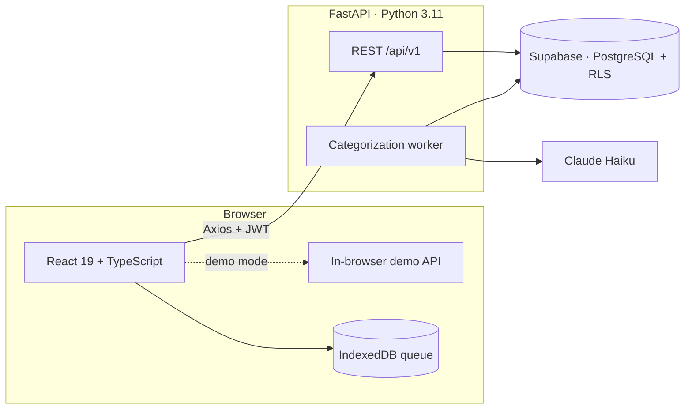

- **The demo needs no server.** In demo mode the Axios client swaps its transport for an in-memory implementation of the same API, with the same rules (balances, goals, budgets, alerts, projections, undo). The public demo can never go down because a free database fell asleep. See [ADR 0006](docs/adr/0006-in-browser-demo.md).
- **No UI framework.** The design system is plain CSS tokens and a small set of components (`frontend/src/components`), with every chart drawn as SVG by hand and colors checked for color-vision deficiency.
- **Security.** The API validates Supabase JWTs itself (fixed algorithms, audience and expiry) and checks the owner of every account and category before writing; Row Level Security keeps direct database access read-only; the web app ships a Content-Security-Policy without inline scripts; rate limits count per user. Details in [SECURITY.md](SECURITY.md).
- **Exports without heavy dependencies.** The Excel writer is about 200 lines (real `.xlsx`, with formats, frozen header and filters); the PDF is drawn with jsPDF and only loaded when someone exports.

Architecture decisions are recorded in [`docs/adr`](docs/adr) and the trade-offs in [`docs/architecture.md`](docs/architecture.md).

---

## Getting started

### The demo, locally (no backend)

```bash
git clone https://github.com/alyssom-fernandes/FlowTrack.git
cd FlowTrack
npm install --prefix frontend
npm --prefix frontend run dev
```

Open `http://localhost:5173` and click **Try the demo**. Without Supabase variables the app runs in demo-only mode.

### The full stack

Requirements: Node.js 20+, Python 3.11+ and a [Supabase](https://supabase.com) project.

1. Run `docs/schema.sql` in the Supabase SQL editor.
2. Copy the environment files and fill them in:
   ```bash
   cp frontend/.env.example frontend/.env.local
   cp backend/.env.example backend/.env
   ```
3. Install the backend:
   ```bash
   cd backend
   python -m venv .venv
   .venv\Scripts\activate          # Windows
   # source .venv/bin/activate     # macOS / Linux
   pip install -r requirements.txt
   ```
4. From the repository root, start both: `npm install` and then `npm run dev`. Frontend on `http://localhost:5173`, API on `http://localhost:8000` (docs at `/docs`).

| Frontend (`frontend/.env.local`) | |
|---|---|
| `VITE_API_URL` | Backend URL |
| `VITE_SUPABASE_URL`, `VITE_SUPABASE_ANON_KEY` | Supabase project (leave empty for demo-only) |

| Backend (`backend/.env`) | |
|---|---|
| `SUPABASE_URL`, `SUPABASE_ANON_KEY`, `SUPABASE_SERVICE_ROLE_KEY`, `SUPABASE_JWT_SECRET` | Supabase project |
| `ANTHROPIC_API_KEY` | Claude API key (optional: without it, insights fall back to plain numbers) |
| `INTERNAL_API_TOKEN` | Secret for the `/internal/*` worker endpoints |
| `CORS_ORIGINS`, `APP_ENV` | Allowed origins and environment |

### Tests

```bash
# Backend: 185 tests (pytest)
cd backend && .venv\Scripts\python -m pytest tests -q

# End to end: 20 scenarios on a desktop and a phone viewport (Playwright, against a local build of the demo)
npm install && npx playwright install chromium && npm run e2e
```

Both run on GitHub Actions on every push to `main` and on pull requests. There is also a screenshot script, `frontend/scripts/fotos/rodar.mjs`, that captures every screen, modal and empty state at 1366 and 375 pixels in both themes, and fails if the browser logged any error; and `frontend/scripts/checar-contraste.mjs` measures every pill and badge in the browser and fails below 4.5:1 contrast or 12 px.

---

## Tech stack

| Layer | Technology |
|---|---|
| Frontend | React 19, TypeScript, Vite, React Router, Zustand, Axios, Dexie (IndexedDB), i18next, jsPDF |
| Backend | FastAPI, Python 3.11, Supabase (PostgreSQL + Auth), slowapi, structlog, Sentry |
| AI | Claude Haiku, behind rules and a merchant cache |
| Testing | pytest, Playwright |
| Hosting | Vercel (frontend and the in-browser demo). The API and the database are set up for Railway and Supabase; the public site runs only the demo. |

## Project structure

```
FlowTrack/
├── frontend/
│   ├── src/
│   │   ├── pages/        One folder per screen (dashboard, transactions, reports, goals, investments, profile, login)
│   │   ├── components/   Design system: tokens, UI components, icons, app shell
│   │   ├── demo/         In-browser API and fictitious data for the demo
│   │   ├── lib/          Excel and CSV writers, category colors, budget pace and status, review rule, theme
│   │   └── i18n/         Portuguese and English, one file per screen
│   └── scripts/fotos/    Screenshot script for every screen and state
├── backend/
│   ├── app/api/v1/       REST endpoints by domain
│   ├── app/integrations/ Categorization worker (rules, cache, Claude) and PDF readers
│   └── tests/            pytest suite
├── e2e/                  Playwright tests
└── docs/                 ADRs, architecture, schema, bank parsers
```

---

## Author

**Alyssom Fernandes** · AFN SYSTEMS · [github.com/alyssom-fernandes](https://github.com/alyssom-fernandes)

Released under the [MIT License](LICENSE).
