# FlowTrack

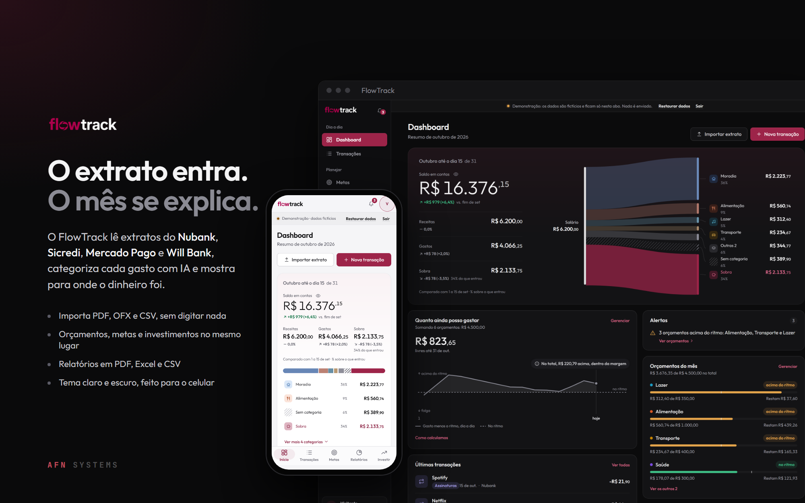

O FlowTrack é um app de finanças pessoais. Ele lê extratos do banco (PDF, OFX ou CSV), categoriza cada gasto com IA e transforma o mês em orçamentos, metas, projeção de saldo e relatórios que dá para exportar. Tem backend em FastAPI sobre o Supabase, frontend em React e uma demonstração que roda inteira no navegador, para qualquer pessoa experimentar sem cadastro.

[](https://github.com/alyssom-fernandes/FlowTrack/actions/workflows/test.yml)
[](https://github.com/alyssom-fernandes/FlowTrack/actions/workflows/e2e.yml)


**Demonstração: [flowtrack-afn.vercel.app](https://flowtrack-afn.vercel.app)** · Este README também está em [inglês](README.md).

## Em 30 segundos

1. Abra a [demonstração](https://flowtrack-afn.vercel.app) e clique em **Ver a demonstração**. Sem conta e sem servidor: os dados são fictícios e ficam só na aba do seu navegador.
2. No **Dashboard**, acompanhe o dinheiro do mês: o que entrou, para quais categorias foi e quanto sobrou. Logo abaixo, **Quanto ainda posso gastar** compara o gasto do mês com o ritmo dos orçamentos (as contas fixas contam no dia em que vencem).
3. Em **Transações**, clique em **Importar** e solte qualquer PDF: a demonstração responde com um extrato de exemplo do Nubank. Antes de salvar, cada lançamento mostra a categoria sugerida e a confiança; depois de importado, o que ficar sem categoria ou com menos de 85% de confiança vai para **A revisar**, onde se confirma com um clique.
4. Em **Relatórios**, escolha um período e acompanhe o dinheiro na seção **Fluxo**; depois use **Exportar** para gerar PDF, Excel ou CSV.
5. Em **Perfil**, troque o idioma para inglês ou o tema para claro.

## Telas

Capturadas da demonstração.

| Dashboard, tema escuro | Transações, tema claro |
|---|---|
| 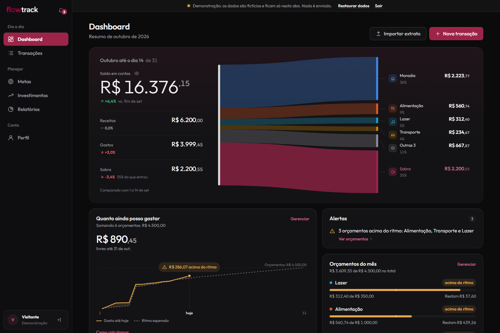 | 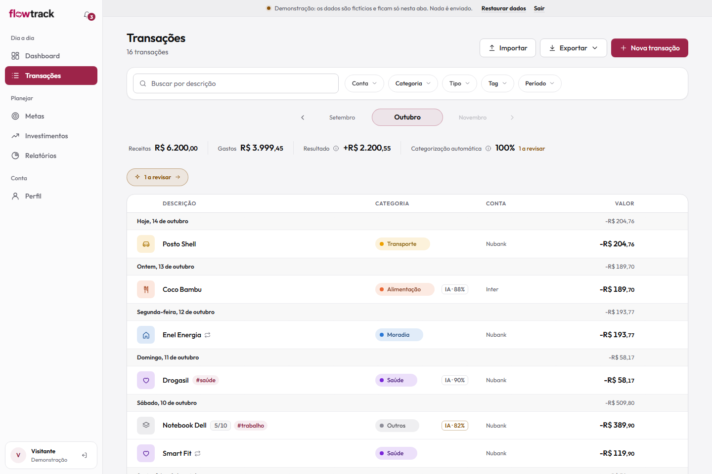 |
| **Relatórios, tema claro** | **Importação de extrato, tema escuro** |
| 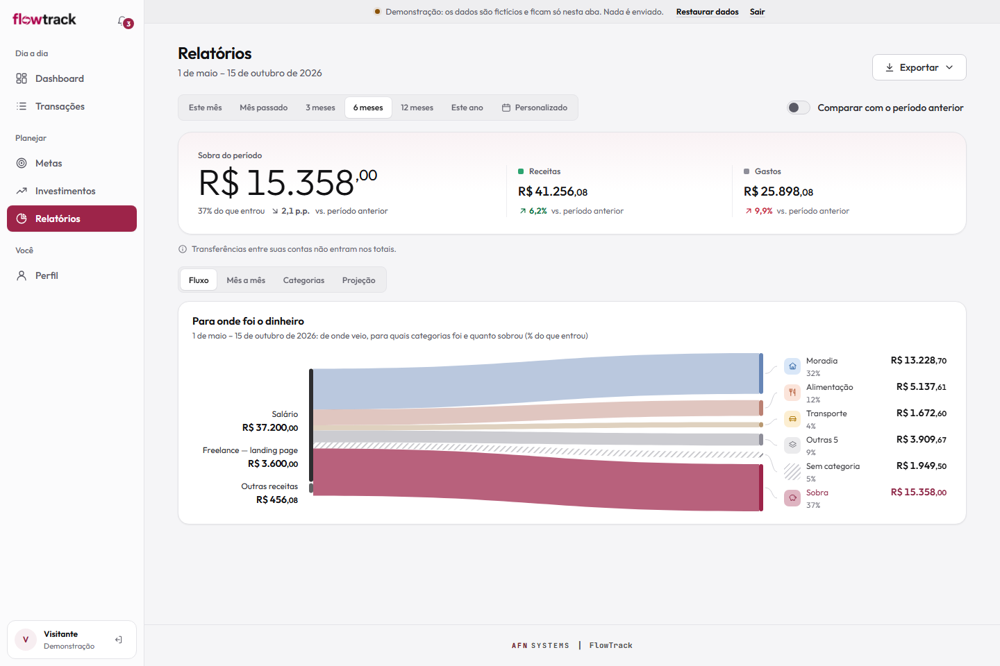 | 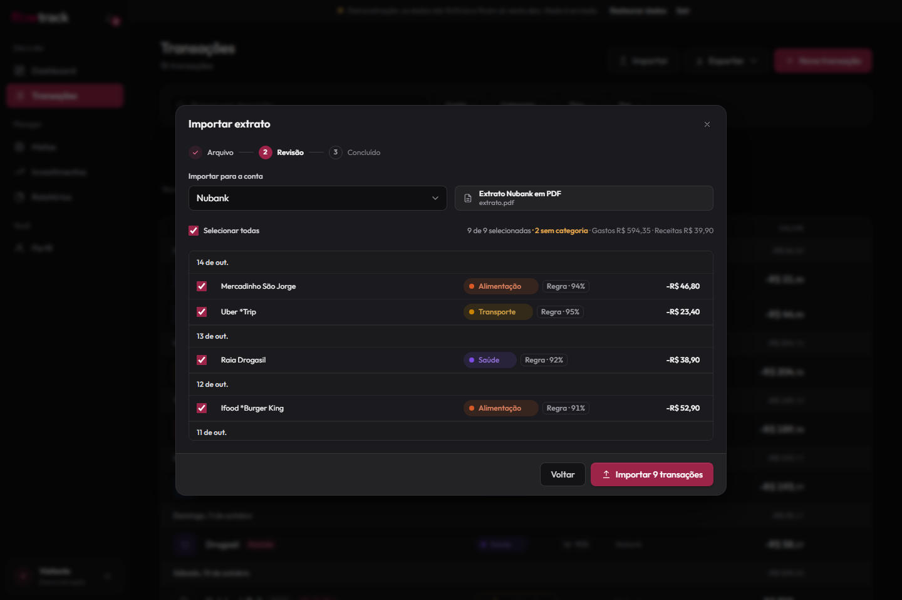 |
| **Orçamentos, tema escuro** | **Entrada, com a demonstração em primeiro lugar** |
| 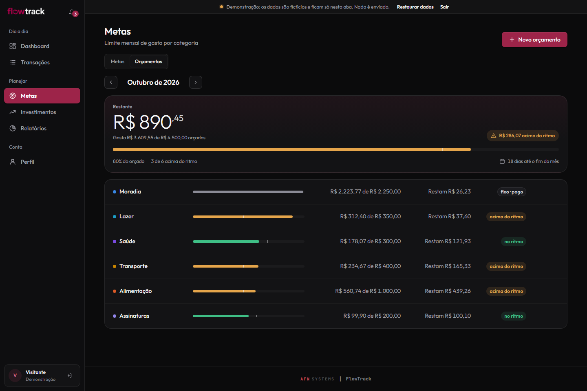 | 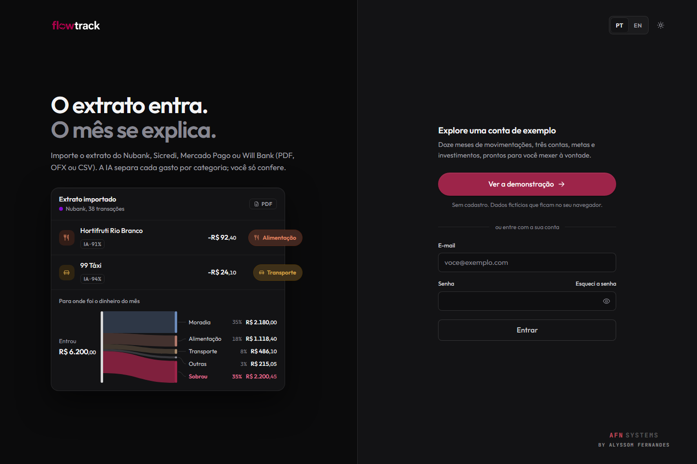 |

| No celular, tema claro | No celular, tema escuro | O relatório em PDF |
|---|---|---|
| 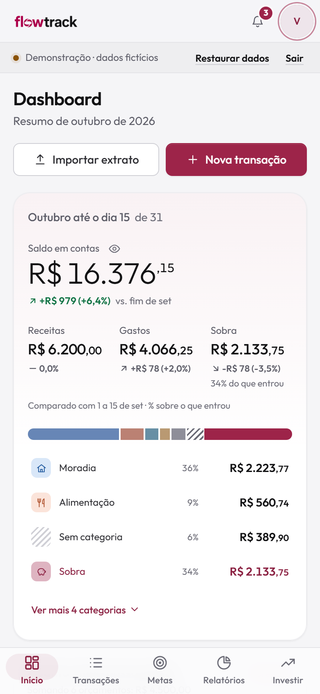 | 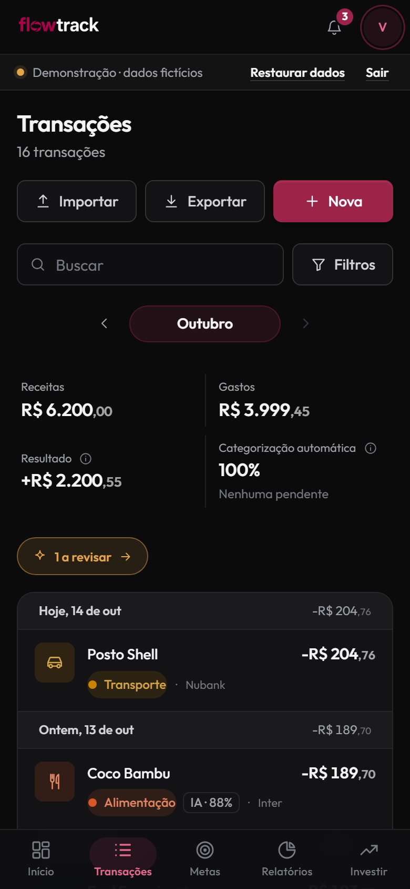 | 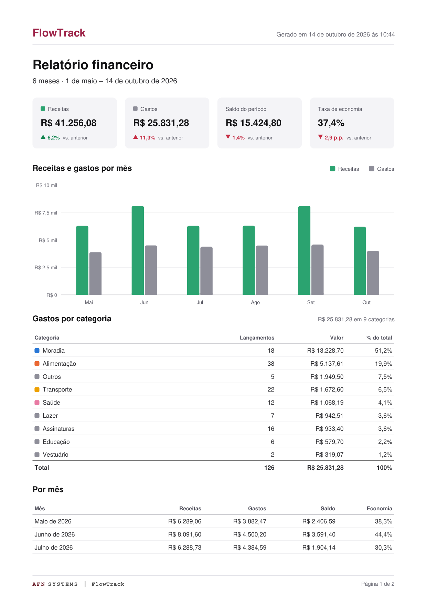 |

---

## Funcionalidades

- **Importação de extratos.** PDF do Nubank, Sicredi, Mercado Pago e Will Bank, OFX de qualquer banco e CSV com mapeamento de colunas. Toda importação passa por uma pré-visualização antes de salvar; os lançamentos de PDF e OFX já vêm com uma categoria sugerida (regras fixas, sem IA) que dá para trocar, e duplicadas são ignoradas.
- **Categorização por IA em três camadas.** Primeiro regras fixas para estabelecimentos conhecidos, depois o cache por estabelecimento de cada pessoa e, para o que sobra, o Claude Haiku. Cada transação mostra como foi categorizada e com que confiança; o que fica sem categoria ou abaixo de 85% de confiança vai para **A revisar**.
- **Dashboard.** O fluxo do dinheiro no mês (as receitas divididas nas categorias de gasto e o que sobrou), comparado aos mesmos dias do mês anterior; quanto ainda dá para gastar no ritmo dos orçamentos; projeção de saldo de 30 dias a partir de recorrentes e parcelas; patrimônio em 12 meses; os orçamentos que pedem atenção primeiro; avisos agrupados por assunto, cada um com uma ação; e um resumo curto do mês escrito por IA. Os valores podem ser ocultados com um clique.
- **Transações.** Mês a mês, agrupadas por dia, com total do dia, busca e filtros em chips (conta, categoria, tipo, tag, período), parcelas ("5/10"), recorrentes, tags, transferências entre contas, categorização direto na lista e o modo **A revisar**. Cada categoria tem a mesma cor em todas as telas e nas exportações.
- **Orçamentos e metas.** Orçamento mensal por categoria, medido pelo ritmo do mês: no ritmo, acima do ritmo, estourou, ou *fixo · pago* quando a categoria é quase só conta fixa e ela já foi paga. O alerta, a barra e a situação dizem sempre a mesma coisa, e a API gera os alertas pela mesma regra. Metas de limite de gasto (também pelo ritmo) ou de economia, acompanhadas automaticamente pelas transações.
- **Investimentos.** Carteira informada à mão, com resultado por ativo e distribuição por tipo.
- **Relatórios.** Qualquer período, comparado ao anterior, em quatro seções: Fluxo (para onde foi o dinheiro, das fontes de renda às categorias), Mês a mês, Categorias com os maiores gastos e projeção de três meses. Cada gráfico tem versão em tabela. Exporta PDF vetorial, Excel com várias abas e CSV; imprime em A4 limpo.
- **Histórico com desfazer.** Toda alteração em transação fica registrada e pode ser desfeita.
- **Dois idiomas, dois temas.** Português e inglês, claro e escuro, pensado para o celular desde o início.
- **Instalável e tolerante a falta de conexão.** É um PWA; transações criadas sem internet entram numa fila e são enviadas quando a conexão volta.

---

## Como é feito

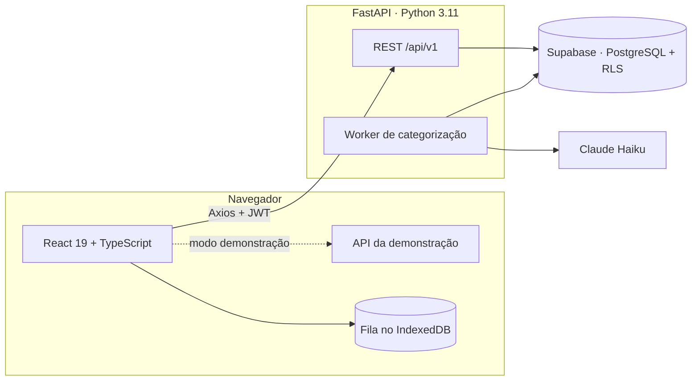

- **A demonstração não precisa de servidor.** No modo demonstração o Axios troca o transporte por uma implementação em memória da mesma API, com as mesmas regras (saldos, metas, orçamentos, alertas, projeções, desfazer). A demonstração pública não cai porque um banco gratuito entrou em pausa. Veja o [ADR 0006](docs/adr/0006-in-browser-demo.md).
- **Sem framework de interface.** O design system é feito de tokens CSS e um conjunto pequeno de componentes (`frontend/src/components`); todos os gráficos são SVG desenhados à mão, com cores conferidas para daltonismo.
- **Segurança.** A API valida o JWT do Supabase por conta própria (algoritmos fixos, audiência e validade) e confere o dono de toda conta e categoria antes de gravar; o Row Level Security deixa o acesso direto ao banco só de leitura; o site tem Content-Security-Policy sem scripts inline; os limites de requisição contam por usuário. Detalhes na [SECURITY.md](SECURITY.md).
- **Exportação sem dependências pesadas.** O gerador de Excel tem cerca de 200 linhas (`.xlsx` de verdade, com formatos, cabeçalho congelado e filtros); o PDF é desenhado com jsPDF, carregado só quando alguém exporta.

As decisões de arquitetura estão em [`docs/adr`](docs/adr) e os trade-offs em [`docs/architecture.md`](docs/architecture.md).

---

## Como rodar

### A demonstração, localmente (sem backend)

```bash
git clone https://github.com/alyssom-fernandes/FlowTrack.git
cd FlowTrack
npm install --prefix frontend
npm --prefix frontend run dev
```

Abra `http://localhost:5173` e clique em **Ver a demonstração**. Sem as variáveis do Supabase o app roda só em demonstração.

### Tudo, com backend

Requisitos: Node.js 20+, Python 3.11+ e um projeto no [Supabase](https://supabase.com).

1. Rode `docs/schema.sql` no editor SQL do Supabase.
2. Copie os arquivos de ambiente e preencha:
   ```bash
   cp frontend/.env.example frontend/.env.local
   cp backend/.env.example backend/.env
   ```
3. Instale o backend:
   ```bash
   cd backend
   python -m venv .venv
   .venv\Scripts\activate          # Windows
   # source .venv/bin/activate     # macOS / Linux
   pip install -r requirements.txt
   ```
4. Na raiz do repositório, `npm install` e depois `npm run dev`. Frontend em `http://localhost:5173`, API em `http://localhost:8000` (documentação em `/docs`).

| Frontend (`frontend/.env.local`) | |
|---|---|
| `VITE_API_URL` | Endereço do backend |
| `VITE_SUPABASE_URL`, `VITE_SUPABASE_ANON_KEY` | Projeto do Supabase (vazio = só demonstração) |

| Backend (`backend/.env`) | |
|---|---|
| `SUPABASE_URL`, `SUPABASE_ANON_KEY`, `SUPABASE_SERVICE_ROLE_KEY`, `SUPABASE_JWT_SECRET` | Projeto do Supabase |
| `ANTHROPIC_API_KEY` | Chave da API do Claude (opcional: sem ela, o resumo mostra só os números) |
| `INTERNAL_API_TOKEN` | Segredo das rotas internas `/internal/*` |
| `CORS_ORIGINS`, `APP_ENV` | Origens permitidas e ambiente |

### Testes

```bash
# Backend: 185 testes (pytest)
cd backend && .venv\Scripts\python -m pytest tests -q

# Ponta a ponta: 20 cenários, no computador e no celular (Playwright, contra um build local da demonstração)
npm install && npx playwright install chromium && npm run e2e
```

Os dois rodam no GitHub Actions a cada envio ao `main` e em pull requests. Há também um roteiro de fotos, `frontend/scripts/fotos/rodar.mjs`, que fotografa cada tela, modal e estado vazio em 1366 e 375 pixels, nos dois temas, e falha se o navegador registrar qualquer erro; e `frontend/scripts/checar-contraste.mjs`, que mede no navegador cada pílula e selo e falha abaixo de 4,5:1 de contraste ou de 12 px.

---

## Tecnologias

| Camada | Tecnologia |
|---|---|
| Frontend | React 19, TypeScript, Vite, React Router, Zustand, Axios, Dexie (IndexedDB), i18next, jsPDF |
| Backend | FastAPI, Python 3.11, Supabase (PostgreSQL + Auth), slowapi, structlog, Sentry |
| IA | Claude Haiku, depois de regras e de um cache por estabelecimento |
| Testes | pytest, Playwright |
| Hospedagem | Vercel (frontend e a demonstração no navegador). A API e o banco estão prontos para Railway e Supabase; o site público roda só a demonstração. |

## Estrutura

```
FlowTrack/
├── frontend/
│   ├── src/
│   │   ├── pages/        Uma pasta por tela (dashboard, transações, relatórios, metas, investimentos, perfil, entrada)
│   │   ├── components/   Design system: tokens, componentes, ícones, estrutura do app
│   │   ├── demo/         API no navegador e dados fictícios da demonstração
│   │   ├── lib/          Geradores de Excel e CSV, cores das categorias, ritmo e situação dos orçamentos, regra de revisão, tema
│   │   └── i18n/         Português e inglês, um arquivo por tela
│   └── scripts/fotos/    Roteiro de fotos de todas as telas e estados
├── backend/
│   ├── app/api/v1/       Rotas REST por domínio
│   ├── app/integrations/ Categorização (regras, cache, Claude) e leitores de PDF
│   └── tests/            Testes com pytest
├── e2e/                  Testes com Playwright
└── docs/                 ADRs, arquitetura, schema, leitores de extrato
```

---

## Autor

**Alyssom Fernandes** · AFN SYSTEMS · [github.com/alyssom-fernandes](https://github.com/alyssom-fernandes)

Licença [MIT](LICENSE).
